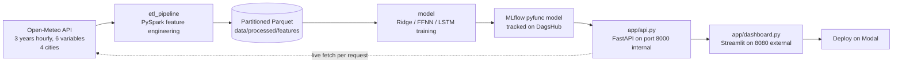

# Short-Term Temperature Forecasting (6-Hour Horizon)

End-to-end machine learning project that forecasts the **temperature 6 hours ahead** for any location, with Colombo, Galle, Berlin and Tokyo as the training cities. Hourly weather history is pulled from [Open-Meteo](https://open-meteo.com/), engineered into features with **PySpark**, and modelled with **scikit-learn / PyTorch**. The winning model is served as an **MLflow pyfunc** (tracked on DagsHub) behind a **FastAPI** service, with a **Streamlit** dashboard on top, deployed on **Google Cloud Run**.

## Architecture



At inference time the API accepts a latitude/longitude, fetches the most recent days of hourly weather straight from Open-Meteo, rebuilds the exact same features in pandas (a port of the Spark logic), and returns the t+6h prediction together with the inference time.

## Repository structure

```
root/
├── etl_pipeline/           # data collection + feature engineering
│   ├── etl_config.py       # cities, variables, windows, paths
│   ├── fetch_data.py       # Open-Meteo download -> raw Parquet per city
│   ├── features.py         # PySpark lags, rolling windows, cyclical + physics features
│   ├── run_etl_pipeline.py # Spark runner, writes partitioned Parquet
│   └── requirements.txt
├── model/                  # training and model packaging
│   ├── config.py           # split lengths, feature list, hyperparameters
│   ├── models.py           # FFNN and LSTM definitions (PyTorch)
│   ├── train.py            # prepare data, train, evaluate, save
│   └── inference.py        # MLflow pyfunc packaging + live fetch/feature port
└── app/                    # self-contained serving application
    ├── inference.py        # copy of the fetch + feature-engineering functions
    ├── api.py              # FastAPI: lat/lon -> t+6h prediction
    ├── dashboard.py        # Streamlit UI calling the API
    ├── start.sh            # starts both services in one container
    ├── Dockerfile
    └── requirements.txt
```

## 1. Data and ETL (`etl_pipeline/`)

**Data:** 3 years of hourly observations from the Open-Meteo Archive API for four cities:

| City | Latitude | Longitude |
|---|---|---|
| Colombo | 6.9271 | 79.8612 |
| Galle | 6.0338 | 80.2164 |
| Berlin | 52.5200 | 13.4050 |
| Tokyo | 35.6895 | 139.6917 |

**Variables:** `temperature_2m`, `relative_humidity_2m`, `surface_pressure`, `cloud_cover`, `wind_speed_10m`, `shortwave_radiation`.

The feature engineering runs as PySpark window functions, partitioned by city and ordered by timestamp, and writes a partitioned Parquet dataset. Per timestamp `t` it builds:

| Feature group | Details |
|---|---|
| Lags | temperature, surface pressure, shortwave radiation at t-1/3/6/24h |
| Rolling stats | mean and std over 6h and 24h windows for the same three variables |
| Cyclical encodings | sin/cos of hour-of-day and day-of-year (UTC) |
| Targets | `temperature_2m` at t+6h via a lead window |

##### Extra features added to improve accuracy

- temperature lags at t-12h and t-48h (trend persistence over longer horizons)
- 48h pressure rolling mean (synoptic-system approach detection)
- 3h radiation rolling mean and 6h humidity rolling mean (short-term cloud/moisture state)
- solar elevation angle (NOAA approximation) and a Haurwitz clear-sky irradiance model, combined into a clear-sky index (null at night and in the 0-3 degree twilight zone)
- `is_daylight`, `temp_delta_3h`, and `temperature_anomaly_24h` (departure from the daily mean)

See `etl_pipeline/README.md` for details on running it.

## 2. Models and training (`model/`)

**Split (chronological, no leakage):** first 24 months train, next 6 months dev (early stopping), final ~6 months (most recent) validation holdout. The `StandardScaler` is fitted on the training split only.

**Models trained and compared:**

| Model | Description |
|---|---|
| Ridge regression | linear baseline, fixed alpha = 1.0 |
| FFNN | 256-128-64, BatchNorm + ReLU + Dropout (0.20/0.15/0.10), Huber loss, AdamW, early stopping on dev MAE |
| LSTM | 2 x 64 layers over 48-hour raw sequences, challenger architecture |

The FFNN won on validation MAE (the temporal context is already captured by the engineered features, so the LSTM's raw sequences added little):

| Split | MAE (degC) | RMSE (degC) | R2 |
|---|---|---|---|
| Test (6 months) | 1.144 | 1.758 | 0.974 |
| Validation (most recent ~6 months) | 0.909 | 1.269 | 0.958 |

Training was CPU-only, has fixed hyperparameters (no tuning), and saves `model/ffnn.pt`, `model/scaler.joblib` (plus the Ridge/LSTM artifacts for reference).

## 3. Serving (`app/`)

### MLflow model

The trained FFNN and its scaler are packaged as an **MLflow pyfunc model** (`WeatherForecaster`: scaler + city one-hot + preprocessing all baked in) and published to a DagsHub-hosted MLflow tracking server. The app loads it at startup with `mlflow.pyfunc.load_model()` — no local model files are needed in the container.

### FastAPI service (`api.py`, internal port 8000)

| Endpoint | Purpose |
|---|---|
| `GET /health` | liveness + loaded model URI |
| `POST /predict` | forecast for coordinates |

`POST /predict` request:

```json
{"latitude": 6.9271, "longitude": 79.8612}
```

`POST /predict` response:

```json
{
  "city": "colombo",
  "latitude": 6.9271,
  "longitude": 79.8612,
  "observed_at": "2026-11-22T10:00:00+00:00",
  "temperature_now_c": 29.1,
  "forecast_time": "2026-11-22T16:00:00+00:00",
  "predicted_temperature_c": 28.7,
  "inference_ms": 12.3,
  "fetch_ms": 350.1,
  "total_ms": 400.2
}
```

Per request the service fetches ~4 days of hourly data from the Open-Meteo Forecast API (the Archive API lags several days), rebuilds the features with the pandas port in `app/inference.py`, and predicts the latest fully-observed hour. If that hour falls in the dawn/dusk band where the clear-sky index is null by design, it steps back up to 6 hours rather than returning NaN.

### Streamlit dashboard (`dashboard.py`, external `$PORT`)

City presets (or custom coordinates), one button, and the result: temperature now vs. t+6h, the change, the inference time, and the raw API response in an expandable section. The dashboard talks to the API over the internal port (`API_URL`, default `http://localhost:8000`).

## Getting started

### 1. Run the ETL (one-time)

```bash
cd etl_pipeline
pip install -r requirements.txt
python run_etl_pipeline.py     # fetches 3 years x 4 cities, writes partitioned Parquet
```

### 2. Train the models (one-time)

```bash
cd model
pip install -r requirements.txt
python train.py                # trains Ridge + FFNN + LSTM, prints the comparison, saves artifacts
```

### 3. Publish the model to DagsHub (one-time)

The `WeatherForecaster` pyfunc (FFNN + scaler) is logged to the DagsHub MLflow tracking server and registered as `weather-6h-temp`; the API loads `models:/weather-6h-temp/latest`.

### 4. Run the app locally

```bash
cd app
pip install -r requirements.txt

# in one shell
uvicorn api:app --host 0.0.0.0 --port 8000
# in another
streamlit run dashboard.py --server.port 8080
```

### 5. Build and Run the Dockerfile Locally


```bash
docker build -t openmeteo-forecaster-dashboard:latest .
docker run --rm -p 8080:8080 -p 8000:8000 --name openmeteo-forecaster openmeteo-forecaster-dashboard:latest
```

## Environment variables

| Variable | Used by | Description |
|---|---|---|
| `MLFLOW_TRACKING_URI` | api.py | DagsHub MLflow endpoint, e.g. `https://dagshub.com/<owner>/<repo>.mlflow` |
| `MLFLOW_TRACKING_USERNAME` | api.py | DagsHub username (set as a Cloud Run secret) |
| `MLFLOW_TRACKING_PASSWORD` | api.py | DagsHub access token (set as a Cloud Run secret) |
| `MLFLOW_MODEL_URI` | api.py | optional, default `models:/weather-6h-temp/latest` |

## Design notes

- **Identical features offline and online.** The pandas feature engineering in `app/inference.py` mirrors the Spark semantics exactly: time-range rolling windows `(t-h, t]`, sample std with `ddof=1`, and the same night-time cleaning (clear-sky index filled with 0 where `is_daylight == 0`).
- **No retraining at serving time.** The pyfunc model bundles the fitted scaler; the API only fetches data, engineers features and predicts.
- **Coordinate handling.** Coordinates within ~1 degree of a training city are labelled with that city's one-hot; other locations get all-zero one-hots. Predictions are most reliable for the four training cities.
- **CPU-only inference.** The model runs on CPU (`map_location="cpu"`), which is plenty for a single-row prediction and keeps the container image small.
